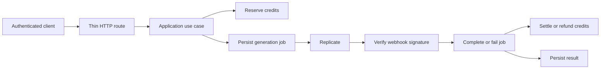

# The Forge Community / STAKE & SCALE

A fullstack platform for founder collaboration, venture workspaces and AI-assisted workflows. The code combines a Next.js application, a PostgreSQL domain model, usage-based AI credits and asynchronous media jobs.

**[Website](https://www.stakeandscale.de/)** · [Dreamtelligence](https://www.dreamtelligence.de/)

## Engineering focus

- Next.js 16 App Router, React 19, TypeScript and Tailwind CSS 4.
- Prisma 7 and PostgreSQL for users, squads, ventures, tasks, documents and financial records.
- Auth.js v5 beta with server-side sessions and ownership checks at application boundaries.
- AI SDK integrations for Google/OpenAI, plus asynchronous Replicate media jobs.
- Credit reservation before generation and settlement or refund on completion/failure.
- Persisted job state, signed webhook verification and tests for repeated webhook delivery.
- A warehouse module with explicit separation between customer and operator access.
- Architecture checks that enforce module boundaries and migration layout.

This is a modular monolith. The repository includes community, legal-document, billing and integration modules as well as AI workflows. Their presence is not a claim that every product flow is currently validated for public use.

## One representative flow: AI media generation



The layers for this flow live in `lib/ai/contracts`, `domain`, `application` and `infrastructure`. Tests exercise the flow with controlled provider/storage dependencies. They do not spend provider credits.

## Run checks without service credentials

Use Node.js 24 and npm 10.9.4, as declared in `package.json`:

```bash
git clone https://github.com/dreamtelligence/the-forge-community.git
cd the-forge-community
npm ci
npx prisma generate
npm run check:architecture
npm run typecheck
npm run test:warehouse:boundary
npm run test:marketing:media
npm run test:webhook:replicate
```

GitHub Actions runs these checks on pushes and pull requests. Prisma client generation does not require a running database. These checks cover selected boundaries and workflows, not the entire platform or live integrations.

## Local application setup

1. Copy `.env.example` to `.env.local` and configure your own PostgreSQL database, authentication secret and login provider.
2. Install dependencies and generate the Prisma client as above.
3. Apply the canonical migrations to a dedicated development database:

```bash
npm run migrate:deploy
npm run dev
```

The migration command changes the configured database. Set both `DATABASE_URL` (application connection) and `DIRECT_URL` (unpooled migration connection). Canonical migrations are in `prisma/migrations/`; scripts in `prisma/manual_sql/` and archived SQL are not a second migration chain. Avoid `prisma db push` on an existing deployment.

The application is served at `http://localhost:3000`. Email login needs a configured Resend account; Google login is optional. Beta-access rules may also restrict login. Provider keys enable their respective AI features. Stripe price IDs, webhook secrets and account configuration must match your own test environment before exercising billing. The example environment file lists core settings, not every optional integration.

For a production build, configure the required runtime services and run `npm run build`, followed by `npm start`. Secrets belong in the deployment environment, never in browser code or source control.

## Code map

| Area | Path |
| --- | --- |
| Pages, actions and HTTP routes | `app/` |
| Authentication | `auth.ts`, `auth.config.ts` |
| AI application/domain/infrastructure layers | `lib/ai/` |
| Credit and financial ledger | `lib/finance/` |
| Warehouse access boundary | `lib/warehouse/` |
| Provider integrations | `lib/integrations/` |
| Data model and migrations | `prisma/` |
| Deterministic workflow tests | `scripts/tests/` |
| Architecture and deployment notes | `docs/architecture/`, `docs/DEPLOYMENT-SECURITY.md` |

Read [repository boundaries](docs/architecture/repo-boundaries.md) and the [modular monolith notes](docs/architecture/modular-monolith.md) before moving code across modules.

## Verification scope

The `test:smoke:*` scripts use real application services and can write data or start paid generation jobs. They require a dedicated test deployment and are not part of the credential-free CI job. Billing, email delivery, complete tenant isolation, provider availability, migration recovery and load behavior need separate integration checks.

Older documents in `docs/` include historical plans and deployment evidence. A past result is not a fresh verification of the current deployment. This portfolio update does not certify legal templates, financial workflows or production readiness.

## Source terms

Published for portfolio review. No project-wide open-source license is granted by this repository; third-party packages, services and assets retain their own terms.
